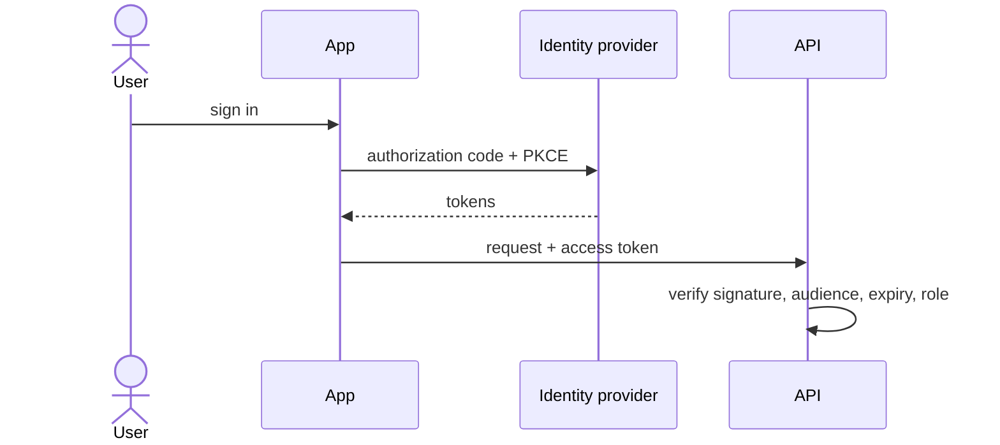

# Authentication and authorization

## Roles × permissions

| Permission | admin | operator | customer |
|---|---|---|---|
| View own transactions | ✓ | ✓ | ✓ |
| Refund | ✓ | ✓ | — |

Where each check is enforced: `file:symbol`.

## Secrets

Where secrets live, who can read them, how they rotate.
