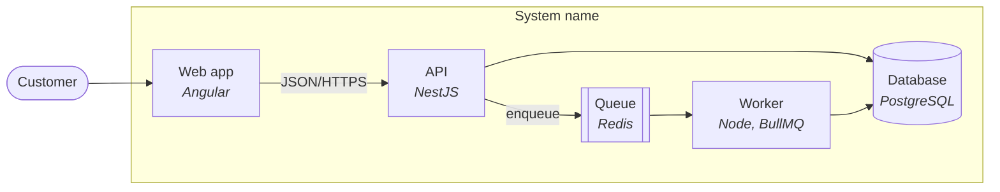

# Containers

Every deployable unit and data store, and how they talk.

| Container | Technology | Responsibility | Code | Deployed as |
|---|---|---|---|---|
| API | NestJS | … | `apps/api/` | … |

## Open questions

- …
