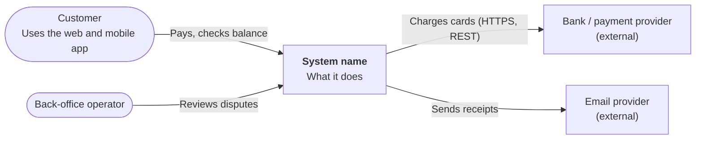

# System context

One paragraph: what the system does and for whom.

| Actor or system | Role | Integration | Owner |
|---|---|---|---|
| Customer | … | Web, mobile | — |
| Bank | … | REST over mTLS, webhooks | TBD |

## Open questions

- …
