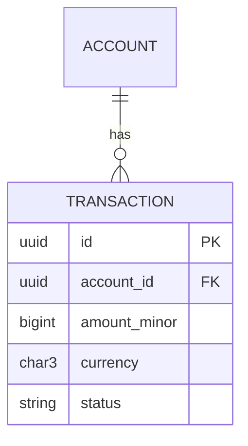

# Data model

## Data dictionary

| Entity.field | Type | Meaning | Valid values | Units / precision | Written by |
|---|---|---|---|---|---|
| transaction.amount_minor | bigint | Amount in the currency's minor unit | > 0 | minor units (cents) | `PaymentsService.capture` |
| transaction.currency | char(3) | ISO 4217 code | `MXN`, `USD` | — | API input, validated in … |
| transaction.status | enum | Lifecycle state, see [states](states.md) | `pending`, `captured`, … | — | … |

## Money rules

Where rounding happens, the rounding mode, how currencies convert and at which rate source. Grounded in code or `TBD`.

## Retention

How long each entity is kept and how it is deleted or anonymized. `TBD` until stated.
