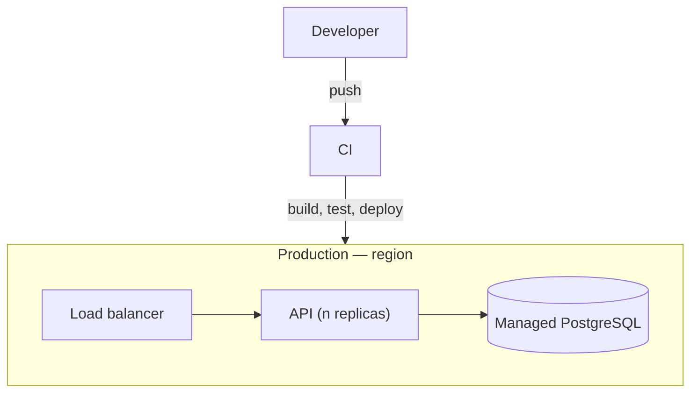

# Deployment

| Environment | URL | Where it runs | Deployed by | Data |
|---|---|---|---|---|
| dev | … | … | … | synthetic |
| staging | … | … | … | … |
| prod | … | … | … | real |

## Deploy flow

Steps from merge to production, with the workflow file for each.

## Open questions

- …
