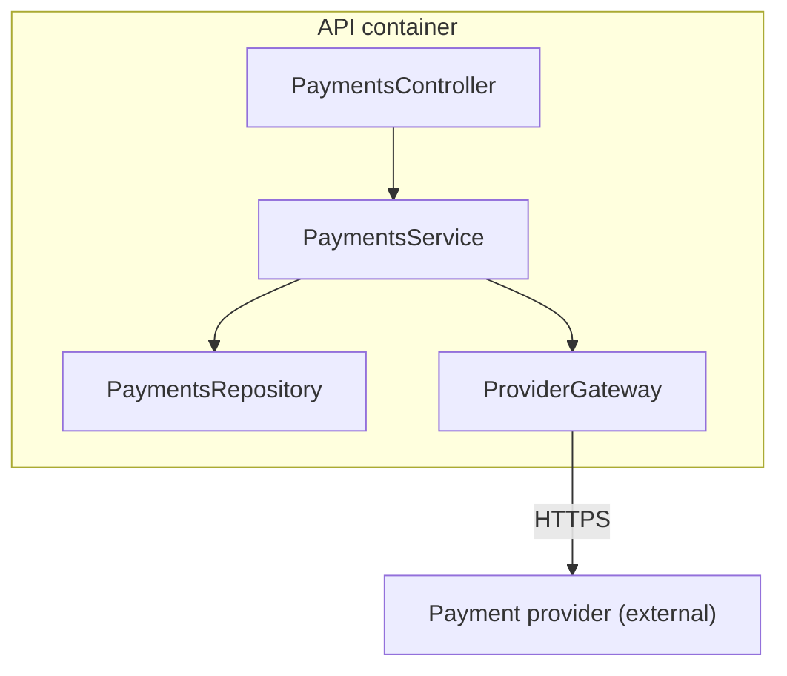

# Feature name

What it does, for whom, and the main use cases (one line each).

## Components (C4 level 3)

| Component | Responsibility | Code |
|---|---|---|
| PaymentsService | … | `src/payments/payments.service.ts` |

## Depends on / used by

- Uses: …
- Used by: …

## See also

[Data](data.md) · [States](states.md) · [Flows](flows.md) · ADRs: [NNNN](../../adr/NNNN-title.md)
