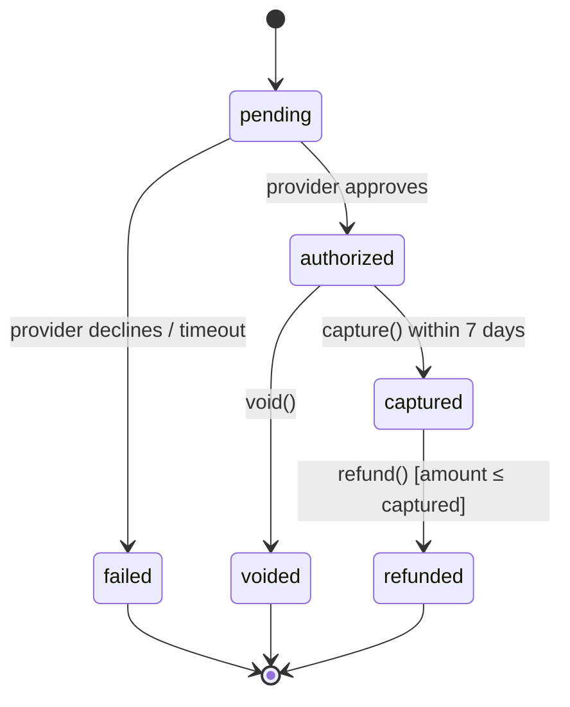

# States

## Entity name

| From | To | Trigger | Guard | Code |
|---|---|---|---|---|
| pending | authorized | provider webhook `payment.approved` | — | `WebhookHandler.onApproved` |

## Findings

Transitions the code allows but should not (or should allow but does not), states never reached, terminal states that can still change.
